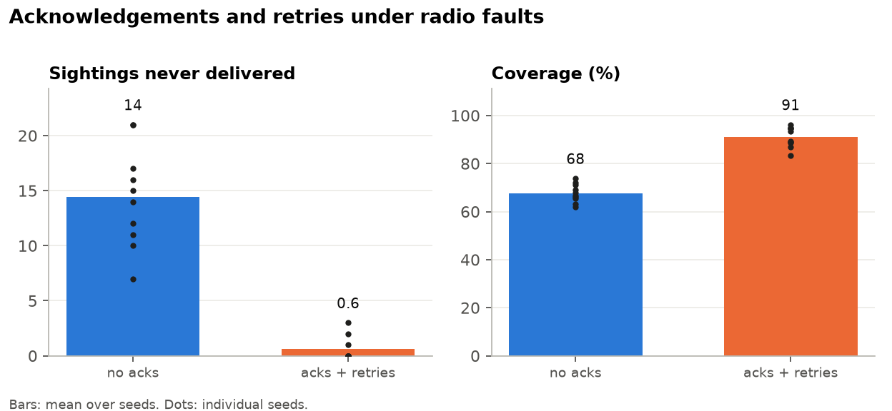
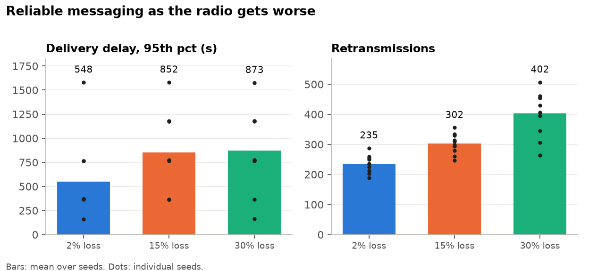
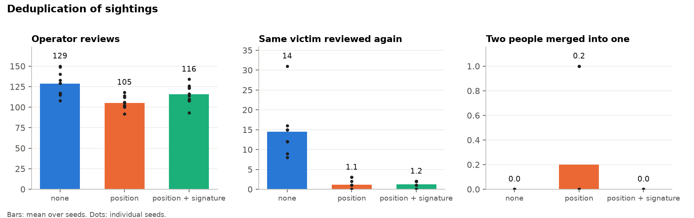
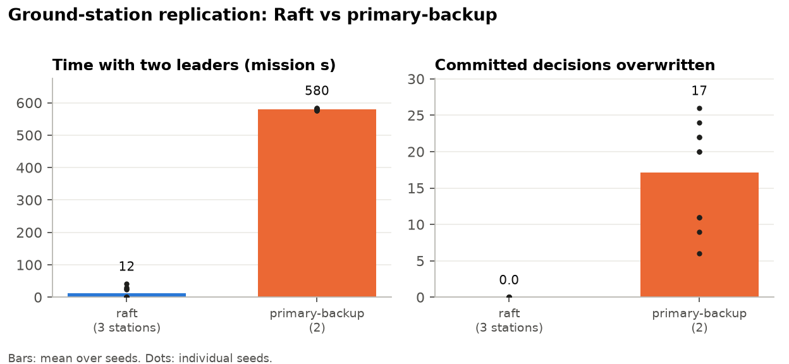
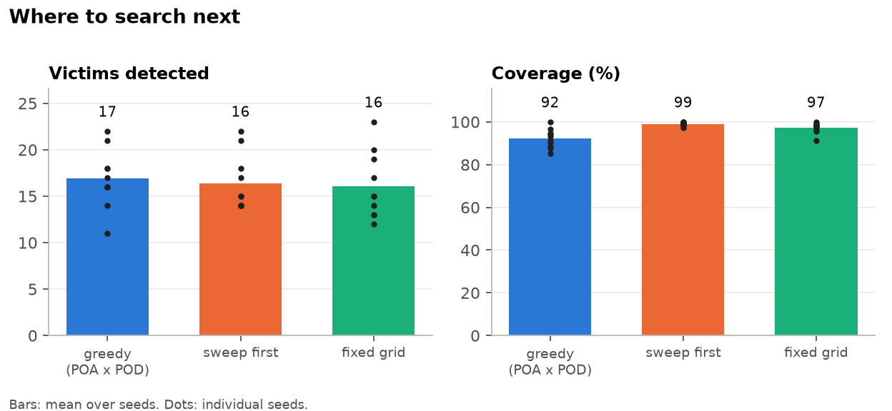
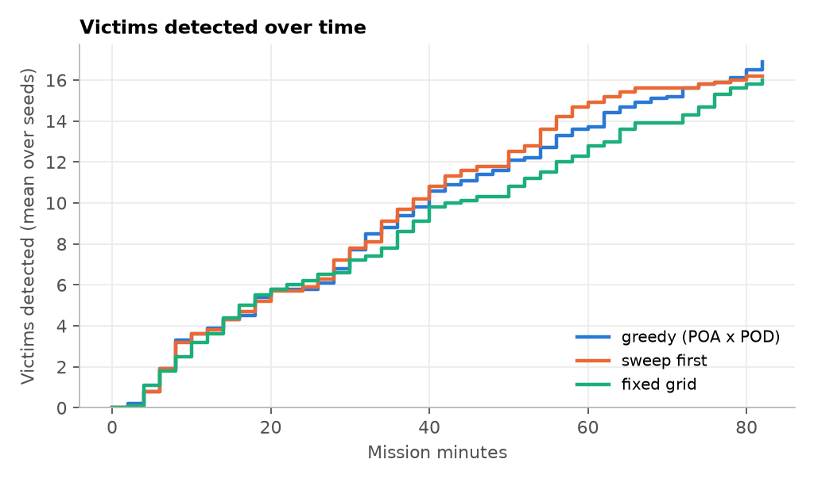
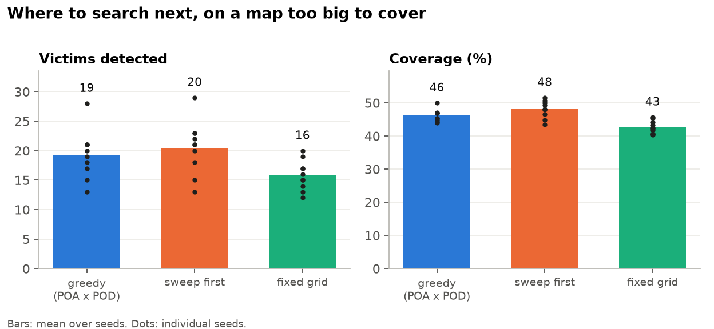
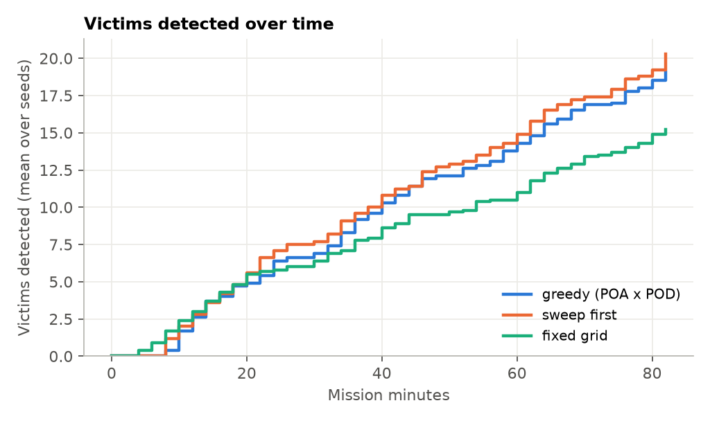
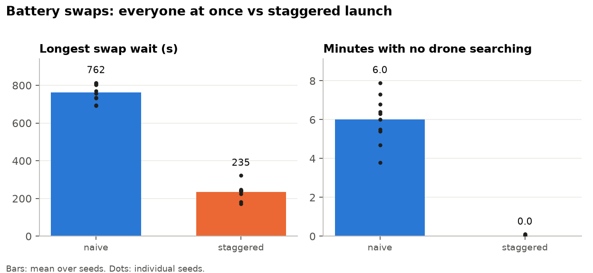
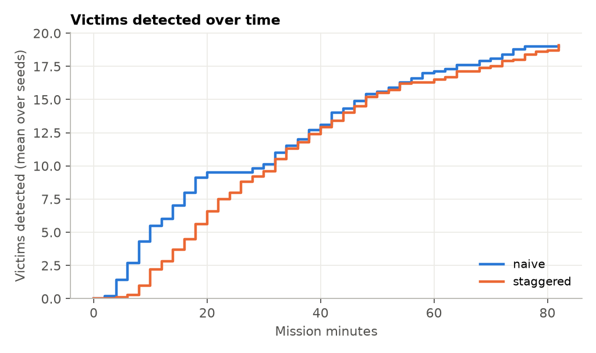

# Experiment results

Generated by `python -m sar.tools.experiments`. Each number is measured against ground truth from the world server's event log. Per-run data: `<experiment>/runs.csv`; the runs themselves: `<experiment>/runs/`.

## Acknowledgements and retries under radio faults

**Question.** Do acks, retries and store-and-forward stop sightings from being lost when links fail?

Scenario `scenarios/step2.yaml`, seeds 42, 43, 44, 45, 46, 47, 48, 49, 50, 51. Mean over seeds, range in brackets.

| Measure | no acks | acks + retries |
|---|---|---|
| Sightings sent | 49.2 (38.0-65.0) | 49.4 (38.0-63.0) |
| Sightings never delivered | 14.4 (7.0-21.0) | 0.6 (0.0-3.0) |
| Delivery delay, 95th pct (s) | 3.9 (2.6-4.4) | 528 (365-775) |
| Retransmissions | 0.0 | 246 (197-303) |
| Coverage (%) | 67.7 (61.9-73.8) | 91.1 (83.4-96.2) |
| Victims confirmed | 10.6 (8.0-14.0) | 13.6 (10.0-17.0) |

## Reliable messaging as the radio gets worse

**Question.** How do delay and losses grow with base packet loss (acks on)?

Scenario `scenarios/step2.yaml`, seeds 42, 43, 44, 45, 46, 47, 48, 49, 50, 51. Mean over seeds, range in brackets.

| Measure | 2% loss | 15% loss | 30% loss |
|---|---|---|---|
| Sightings never delivered | 0.7 (0.0-5.0) | 2.1 (0.0-9.0) | 1.7 (0.0-5.0) |
| Delivery delay, median (s) | 2.1 (2.0-2.2) | 7.8 (2.1-53.2) | 13.7 (2.1-57.7) |
| Delivery delay, 95th pct (s) | 548 (160-1582) | 852 (365-1582) | 873 (164-1578) |
| Retransmissions | 235 (189-288) | 302 (247-356) | 402 (264-507) |
| Packets relayed | 1111 (1028-1243) | 875 (783-963) | 693 (592-812) |
| Victims confirmed | 14.1 (11.0-20.0) | 12.8 (9.0-17.0) | 11.6 (8.0-16.0) |

## Deduplication of sightings

**Question.** How much operator work does clustering save, and does it ever merge two different people?

Scenario `scenarios/step3.yaml`, seeds 42, 43, 44, 45, 46, 47, 48, 49, 50, 51. Mean over seeds, range in brackets.

| Measure | none | position | position + signature |
|---|---|---|---|
| Operator reviews | 129 (108-150) | 105 (92-118) | 116 (93-134) |
| Same victim reviewed again | 14.5 (8.0-31.0) | 1.1 (0.0-3.0) | 1.2 (0.0-2.0) |
| Same decoy reviewed again | 9.8 (5.0-20.0) | 9.0 (4.0-16.0) | 8.4 (4.0-13.0) |
| Two people merged into one | 0.0 | 0.2 (0.0-1.0) | 0.0 |
| Review queue wait, median (s) | 34.5 (19.9-45.9) | 33.0 (22.4-49.8) | 33.8 (23.1-47.9) |
| Victims confirmed | 18.2 (15.0-22.0) | 17.8 (13.0-22.0) | 18.6 (15.0-23.0) |

## Ground-station replication: Raft vs primary-backup

**Question.** Under the same station faults, which keeps one leader and never loses a committed decision?

Scenario `scenarios/step4.yaml`, seeds 42, 43, 44, 45, 46, 47, 48, 49, 50, 51. Mean over seeds, range in brackets.

| Measure | raft (3 stations) | primary-backup (2) |
|---|---|---|
| Time with two leaders (mission s) | 12.0 (0.0-41.8) | 580 (575-584) |
| Time without a leader (mission s) | 23.6 (2.3-92.1) | 29.4 (0.0-76.1) |
| Committed decisions overwritten | 0.0 | 17.1 (6.0-26.0) |
| Verdict conflicts | 0.0 | 0.3 (0.0-1.0) |
| Replicas disagreeing at the end | 0.0 | 0.0 |
| Commit latency (ms) | 30.1 (29.4-30.7) | 30.3 (29.6-30.7) |
| Victims confirmed | 17.5 (12.0-21.0) | 17.9 (15.0-21.0) |

## Where to search next

**Question.** Does POA x POD tasking find people sooner than covering the map once, or a fixed grid?

Scenario `scenarios/step5.yaml`, seeds 42, 43, 44, 45, 46, 47, 48, 49, 50, 51. Mean over seeds, range in brackets.

| Measure | greedy (POA x POD) | sweep first | fixed grid |
|---|---|---|---|
| Victims detected | 16.9 (11.0-22.0) | 16.4 (14.0-22.0) | 16.1 (12.0-23.0) |
| Minutes to detect half | 54.7 (33.4-74.8) | 53.5 (33.2-73.3) | 58.3 (39.0-71.9) |
| Minutes to detect 80% | 61.0 (54.4-67.7) | 55.3 (49.3-61.3) | 79.2 (74.8-83.5) |
| Coverage (%) | 92 (85-100) | 99 (97-100) | 97 (91-100) |
| Re-search jobs | 6.0 (3.0-9.0) | 3.6 (3.0-5.0) | 0.0 |
| Victims confirmed | 15.4 (11.0-21.0) | 15.2 (11.0-20.0) | 15.1 (12.0-21.0) |

## Where to search next, on a map too big to cover

**Question.** When four drones cannot cover the area in time, does searching the likely places first find more people?

Scenario `scenarios/step5.yaml`, seeds 42, 43, 44, 45, 46, 47, 48, 49, 50, 51. Mean over seeds, range in brackets.

| Measure | greedy (POA x POD) | sweep first | fixed grid |
|---|---|---|---|
| Victims detected | 19.3 (13.0-28.0) | 20.5 (13.0-29.0) | 15.8 (12.0-20.0) |
| Minutes to detect half | 78.7 | 81.6 | - |
| Coverage (%) | 46.2 (43.9-50.0) | 48.1 (43.5-51.6) | 42.7 (40.4-45.7) |
| Re-search jobs | 1.0 (0.0-3.0) | 0.0 | 0.0 |
| Victims confirmed | 16.4 (11.0-25.0) | 17.1 (11.0-23.0) | 12.8 (8.0-18.0) |

## Battery swaps: everyone at once vs staggered launch

**Question.** Does staggering take-offs remove the swap queue and the gaps with nobody searching?

Scenario `scenarios/step6.yaml`, seeds 42, 43, 44, 45, 46, 47, 48, 49, 50, 51. Mean over seeds, range in brackets.

| Measure | naive | staggered |
|---|---|---|
| Longest swap wait (s) | 762 (692-814) | 235 (171-322) |
| Most drones queued | 3.6 (3.0-4.0) | 1.3 (1.0-2.0) |
| Minutes with no drone searching | 6.0 (3.8-7.9) | 0.0 (0.0-0.1) |
| Drone-minutes searching | 234 (219-245) | 228 (223-234) |
| Victims detected | 19.2 (16.0-23.0) | 19.2 (16.0-24.0) |
| Victims confirmed | 17.7 (15.0-22.0) | 18.0 (16.0-22.0) |

