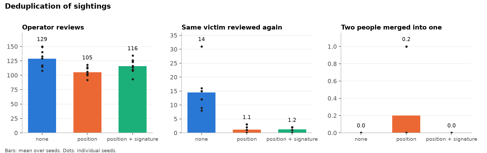

## Deduplication of sightings

**Question.** How much operator work does clustering save, and does it ever merge two different people?

Scenario `scenarios/step3.yaml`, seeds 42, 43, 44, 45, 46, 47, 48, 49, 50, 51. Mean over seeds, range in brackets.

| Measure | none | position | position + signature |
|---|---|---|---|
| Operator reviews | 129 (108-150) | 105 (92-118) | 116 (93-134) |
| Same victim reviewed again | 14.5 (8.0-31.0) | 1.1 (0.0-3.0) | 1.2 (0.0-2.0) |
| Same decoy reviewed again | 9.8 (5.0-20.0) | 9.0 (4.0-16.0) | 8.4 (4.0-13.0) |
| Two people merged into one | 0.0 | 0.2 (0.0-1.0) | 0.0 |
| Review queue wait, median (s) | 34.5 (19.9-45.9) | 33.0 (22.4-49.8) | 33.8 (23.1-47.9) |
| Victims confirmed | 18.2 (15.0-22.0) | 17.8 (13.0-22.0) | 18.6 (15.0-23.0) |

