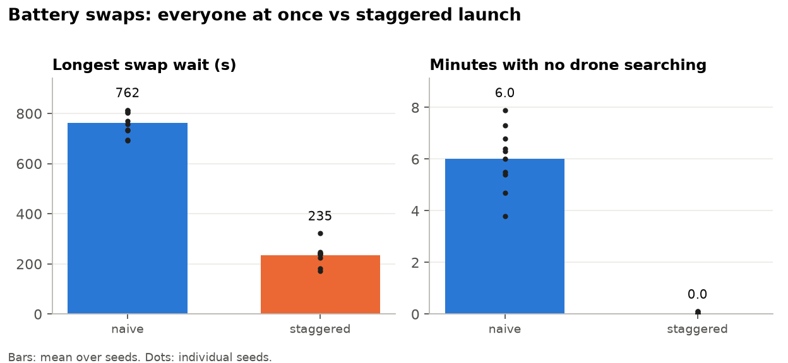
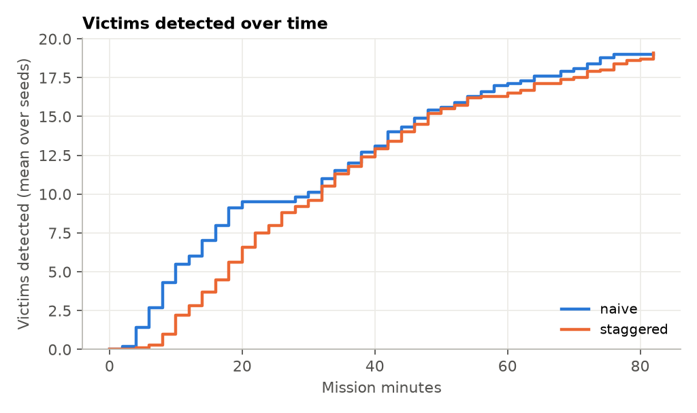

## Battery swaps: everyone at once vs staggered launch

**Question.** Does staggering take-offs remove the swap queue and the gaps with nobody searching?

Scenario `scenarios/step6.yaml`, seeds 42, 43, 44, 45, 46, 47, 48, 49, 50, 51. Mean over seeds, range in brackets.

| Measure | naive | staggered |
|---|---|---|
| Longest swap wait (s) | 762 (692-814) | 235 (171-322) |
| Most drones queued | 3.6 (3.0-4.0) | 1.3 (1.0-2.0) |
| Minutes with no drone searching | 6.0 (3.8-7.9) | 0.0 (0.0-0.1) |
| Drone-minutes searching | 234 (219-245) | 228 (223-234) |
| Victims detected | 19.2 (16.0-23.0) | 19.2 (16.0-24.0) |
| Victims confirmed | 17.7 (15.0-22.0) | 18.0 (16.0-22.0) |

