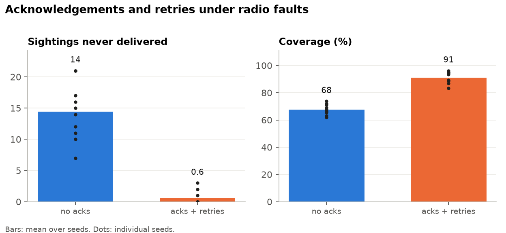

## Acknowledgements and retries under radio faults

**Question.** Do acks, retries and store-and-forward stop sightings from being lost when links fail?

Scenario `scenarios/step2.yaml`, seeds 42, 43, 44, 45, 46, 47, 48, 49, 50, 51. Mean over seeds, range in brackets.

| Measure | no acks | acks + retries |
|---|---|---|
| Sightings sent | 49.2 (38.0-65.0) | 49.4 (38.0-63.0) |
| Sightings never delivered | 14.4 (7.0-21.0) | 0.6 (0.0-3.0) |
| Delivery delay, 95th pct (s) | 3.9 (2.6-4.4) | 528 (365-775) |
| Retransmissions | 0.0 | 246 (197-303) |
| Coverage (%) | 67.7 (61.9-73.8) | 91.1 (83.4-96.2) |
| Victims confirmed | 10.6 (8.0-14.0) | 13.6 (10.0-17.0) |

