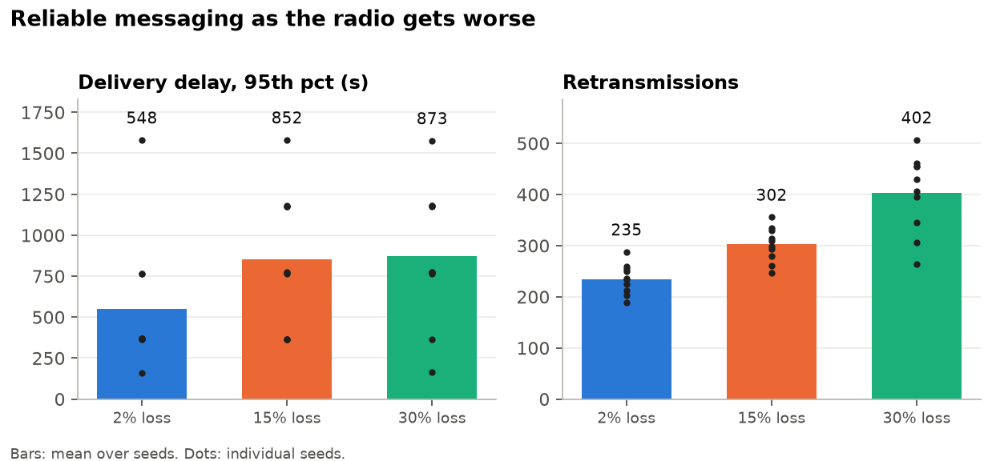

## Reliable messaging as the radio gets worse

**Question.** How do delay and losses grow with base packet loss (acks on)?

Scenario `scenarios/step2.yaml`, seeds 42, 43, 44, 45, 46, 47, 48, 49, 50, 51. Mean over seeds, range in brackets.

| Measure | 2% loss | 15% loss | 30% loss |
|---|---|---|---|
| Sightings never delivered | 0.7 (0.0-5.0) | 2.1 (0.0-9.0) | 1.7 (0.0-5.0) |
| Delivery delay, median (s) | 2.1 (2.0-2.2) | 7.8 (2.1-53.2) | 13.7 (2.1-57.7) |
| Delivery delay, 95th pct (s) | 548 (160-1582) | 852 (365-1582) | 873 (164-1578) |
| Retransmissions | 235 (189-288) | 302 (247-356) | 402 (264-507) |
| Packets relayed | 1111 (1028-1243) | 875 (783-963) | 693 (592-812) |
| Victims confirmed | 14.1 (11.0-20.0) | 12.8 (9.0-17.0) | 11.6 (8.0-16.0) |

