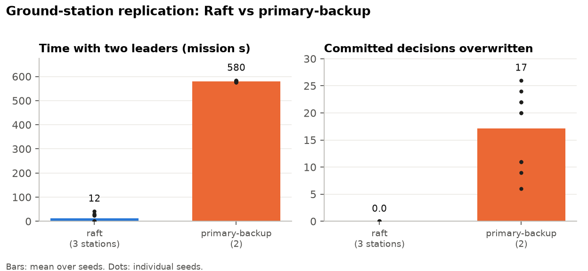

## Ground-station replication: Raft vs primary-backup

**Question.** Under the same station faults, which keeps one leader and never loses a committed decision?

Scenario `scenarios/step4.yaml`, seeds 42, 43, 44, 45, 46, 47, 48, 49, 50, 51. Mean over seeds, range in brackets.

| Measure | raft (3 stations) | primary-backup (2) |
|---|---|---|
| Time with two leaders (mission s) | 12.0 (0.0-41.8) | 580 (575-584) |
| Time without a leader (mission s) | 23.6 (2.3-92.1) | 29.4 (0.0-76.1) |
| Committed decisions overwritten | 0.0 | 17.1 (6.0-26.0) |
| Verdict conflicts | 0.0 | 0.3 (0.0-1.0) |
| Replicas disagreeing at the end | 0.0 | 0.0 |
| Commit latency (ms) | 30.1 (29.4-30.7) | 30.3 (29.6-30.7) |
| Victims confirmed | 17.5 (12.0-21.0) | 17.9 (15.0-21.0) |

