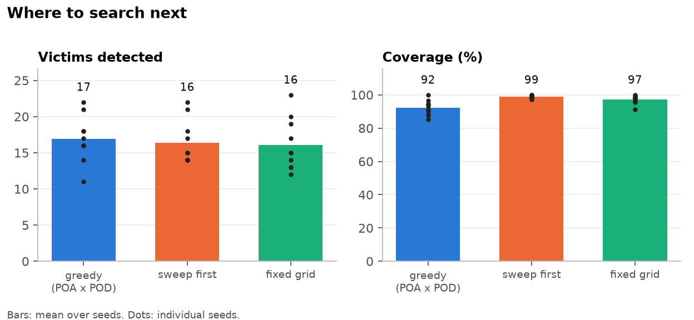
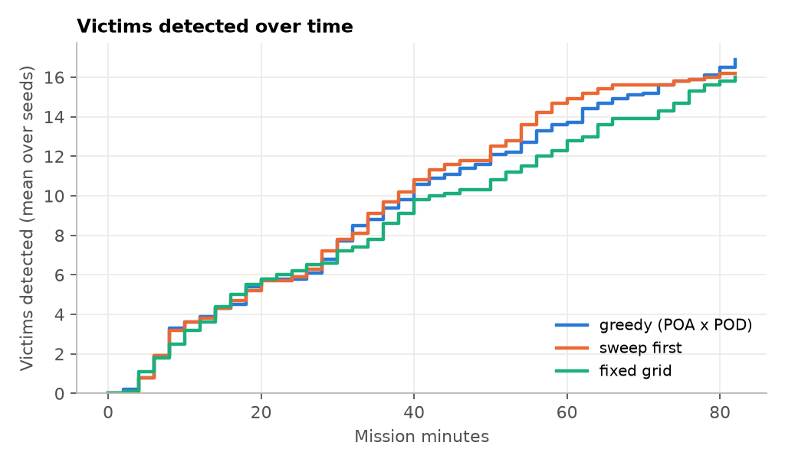

## Where to search next

**Question.** Does POA x POD tasking find people sooner than covering the map once, or a fixed grid?

Scenario `scenarios/step5.yaml`, seeds 42, 43, 44, 45, 46, 47, 48, 49, 50, 51. Mean over seeds, range in brackets.

| Measure | greedy (POA x POD) | sweep first | fixed grid |
|---|---|---|---|
| Victims detected | 16.9 (11.0-22.0) | 16.4 (14.0-22.0) | 16.1 (12.0-23.0) |
| Minutes to detect half | 54.7 (33.4-74.8) | 53.5 (33.2-73.3) | 58.3 (39.0-71.9) |
| Minutes to detect 80% | 61.0 (54.4-67.7) | 55.3 (49.3-61.3) | 79.2 (74.8-83.5) |
| Coverage (%) | 92 (85-100) | 99 (97-100) | 97 (91-100) |
| Re-search jobs | 6.0 (3.0-9.0) | 3.6 (3.0-5.0) | 0.0 |
| Victims confirmed | 15.4 (11.0-21.0) | 15.2 (11.0-20.0) | 15.1 (12.0-21.0) |

