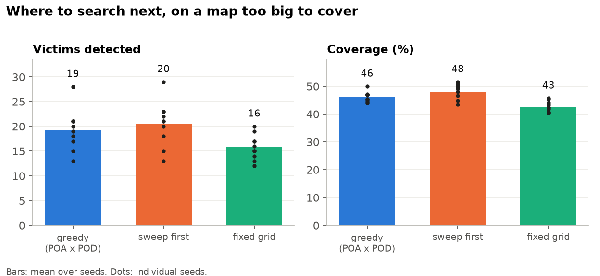
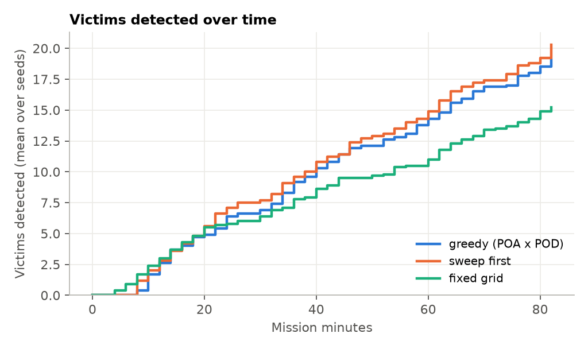

## Where to search next, on a map too big to cover

**Question.** When four drones cannot cover the area in time, does searching the likely places first find more people?

Scenario `scenarios/step5.yaml`, seeds 42, 43, 44, 45, 46, 47, 48, 49, 50, 51. Mean over seeds, range in brackets.

| Measure | greedy (POA x POD) | sweep first | fixed grid |
|---|---|---|---|
| Victims detected | 19.3 (13.0-28.0) | 20.5 (13.0-29.0) | 15.8 (12.0-20.0) |
| Minutes to detect half | 78.7 | 81.6 | - |
| Coverage (%) | 46.2 (43.9-50.0) | 48.1 (43.5-51.6) | 42.7 (40.4-45.7) |
| Re-search jobs | 1.0 (0.0-3.0) | 0.0 | 0.0 |
| Victims confirmed | 16.4 (11.0-25.0) | 17.1 (11.0-23.0) | 12.8 (8.0-18.0) |

